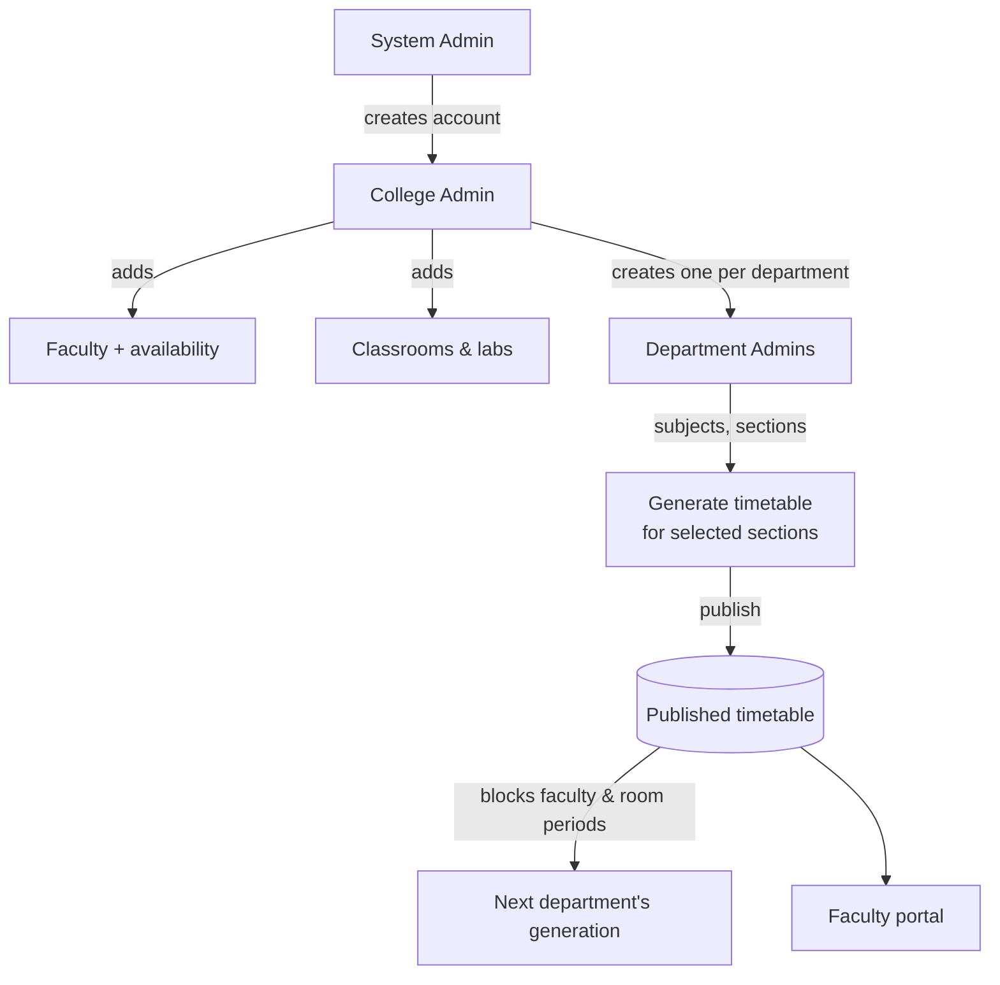
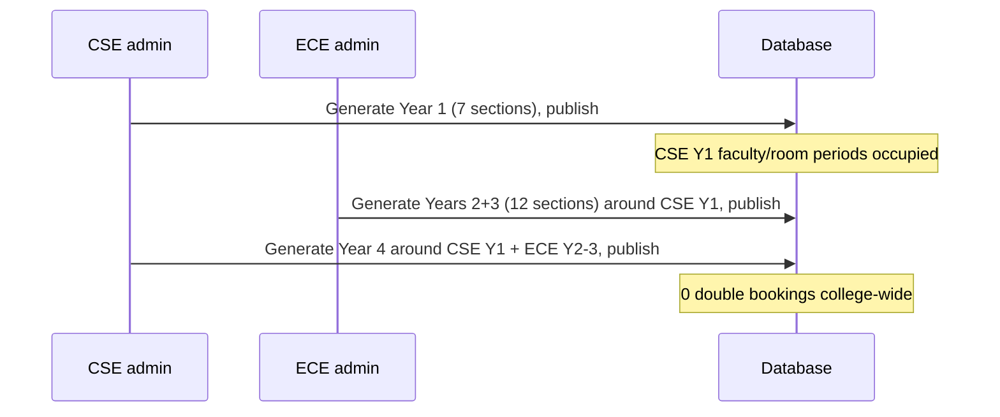
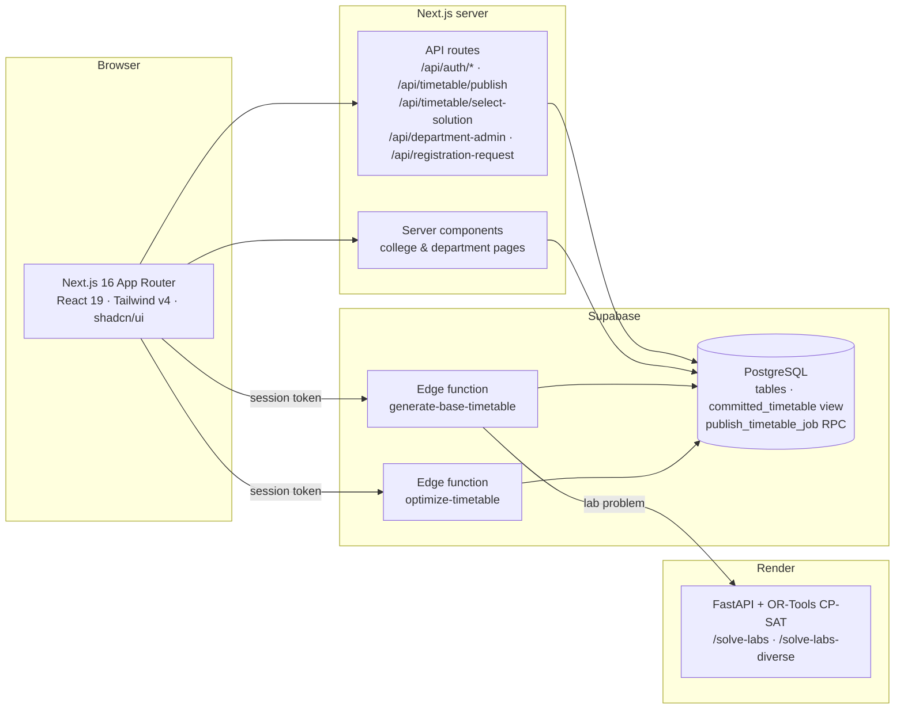
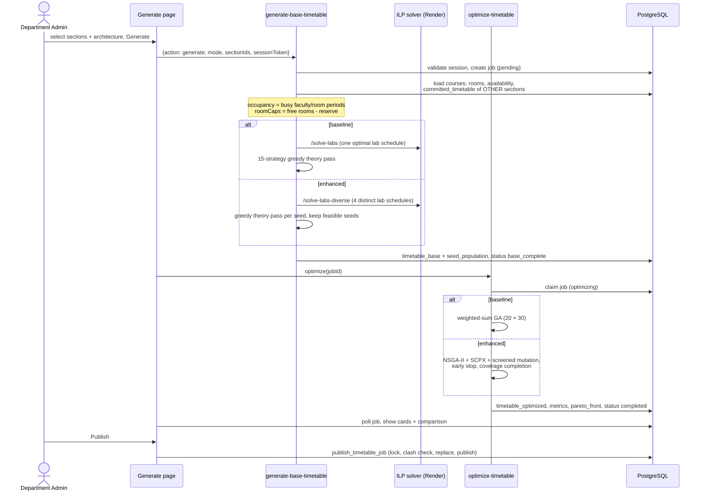
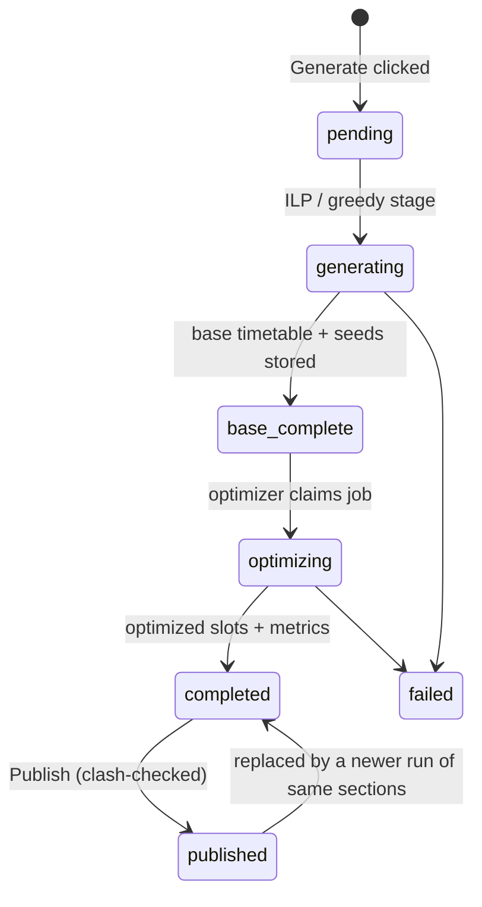

# User Guide & Complete Flow

How every page of the Timetable Scheduling System works, how to generate a timetable **before enhancement** (baseline ILP + GA) and **after enhancement** (research-paper ILP-GA), and how the whole system fits together.

> For algorithm internals see [10 – College Hierarchy & Enhanced ILP-GA](./10-college-hierarchy-and-enhanced-ilp-ga.md). For the data model see [08 – Database Schema](./08-database-schema.md).

---

## 1. Who does what

The system has four roles. Each one only sees its own portal.

| Role | Login page | Lands on | Responsibility |
|------|-----------|----------|----------------|
| **System Admin** | `/login/admin` | `/dashboard/admin` | Creates and manages **college administrator** accounts; approves registration requests |
| **College Admin** | `/login/college-admin` | `/college` | Adds every **faculty** member, their **availability**, the shared **classrooms/labs**, and one **department admin** account per department |
| **Department Admin** | `/login/department-admin` | `/department` | Manages the department's **subjects** and **sections**, then **generates, compares and publishes** timetables for the sections they choose |
| **Faculty** | `/login/faculty` (faculty code + phone) | `/faculty` | Views their combined teaching timetable across all departments |

**Access rules (enforced and tested):**
- Opening a portal page without being signed in redirects to **that portal's** login page.
- A signed-in user who opens another role's page is sent back to their own home page.
- Session tokens are validated server-side (`user_sessions`); a forged or expired token is rejected by the pages, the publish API (403) and the edge functions.

---

## 2. Page-by-page guide

### 2.1 Public pages

| Page | What it does |
|------|--------------|
| `/` Home | Overview of the system and buttons for the four logins. Also has **Request Registration**: a college can ask for an account, and the System Admin approves it. |
| `/login/admin`, `/login/college-admin`, `/login/department-admin` | Username + password. A wrong password shows an error and stays on the page; empty fields cannot be submitted. Links to the other login pages at the bottom. |
| `/login/faculty` | Faculty code (e.g. `U-CSE-F001`) + registered phone number. |

### 2.2 System Admin — `/dashboard/admin`

- **Stats cards:** number of college administrators, how many are active, how many have logged in.
- **College Administrators table:** name, username, college, status, last login.
  - **Add College** creates a college admin account. The college is identified by this account; everything the college admin creates belongs to it.
  - **Edit** updates the details or resets the password. **Delete** removes the college and, by cascade, its data.
- **Registration Requests** (`/dashboard/admin/registration-requests`) lists requests from the home page. **Approve** creates the college admin account and emails the credentials; **Reject** declines the request.

### 2.3 College Admin portal — `/college`

Navigation: **Dashboard · Departments · Faculty · Classrooms · Timetables**

| Page | What it does |
|------|--------------|
| **Dashboard** `/college` | Counts of departments, faculty, classrooms and published timetables; quick actions; the list of committed timetables; the four-step setup guide. |
| **Departments** `/college/departments` | **Add Department** (name + code). For each department you can create, edit or reset the **admin account** (exactly one per department), **Deactivate** or reactivate it, remove the account, or **Delete** the department (asks for confirmation). Shows faculty and section counts per department. |
| **Faculty** `/college/faculty` | The college-wide faculty pool (code, name, email, phone, home department). **Add Faculty**, edit, delete. The **availability** button opens a dialog with: • a **Weekly occupancy** grid. Red periods are already booked by published timetables of *any* department, and every later generation skips them automatically. • **Add Availability Slot** (day, start period, end period). A faculty member with no slots is treated as available all week. |
| **Classrooms** `/college/classrooms` | The shared theory rooms and labs (name, capacity, type, building, floor). Every department schedules into these same rooms, so a published timetable makes a room busy for everyone. |
| **Timetables** `/college/timetables` | Per department, how many sections are published (e.g. `14/28 sections published`), with a badge for each section. **College-wide view** opens `/timetable` with every published timetable of the college. |

### 2.4 Department Admin portal — `/department`

Navigation: **Dashboard · Subjects · Sections · Generate · Timetable**

| Page | What it does |
|------|--------------|
| **Dashboard** `/department` | Department summary and quick links. |
| **Subjects** `/department/subjects` | **Add Subject**: code, name, type (**theory** or **lab**), periods per week, and the faculty who can teach it (searchable, chosen from the whole college pool). Labs are scheduled as **3 continuous periods**. |
| **Sections** `/department/sections` | **Add Section**: name, year level (1–4), student count. The book icon opens **Subjects – \<section\>**, where you assign each subject **with its faculty member** to the section. A section with no subjects cannot be generated. |
| **Generate** `/department/generate` | Generation, comparison, publishing and rescheduling — see §3. |
| **Timetable** `/timetable` | Published timetables of your department, viewable **By Section / By Faculty / By Classroom**. Opening it with `?job=<id>` shows one specific run, even an unpublished one. |

### 2.5 Faculty portal — `/faculty`

- Stats: classes per week, lab sessions, subjects, sections.
- **My Teaching Schedule:** a week grid built from the **published** timetables of **every** department the faculty member teaches for (e.g. a BSH faculty member teaching CSE and ECE sections sees both). A day filter is available.
- **Today's Schedule:** the classes for the current day.
- Until a department publishes, the page says *"Timetable Not Generated Yet"*.

### 2.6 Timetable viewer — `/timetable`

- A dark grid of days × periods P1–P8 (P1 9:00 … P8 4:30, lunch 12:00–1:30). Theory cells are tagged **theory** (green) and labs **lab** (blue), and each cell shows the subject, faculty and room.
- **By Section / By Faculty / By Classroom** tabs, and a selector for the section, faculty member or room.
- **Refresh** reloads. Department admins see their own department; college admins see the whole college.

### 2.7 Colour meanings (used consistently)

| Colour | Meaning |
|--------|---------|
| Blue | Primary action / active navigation item |
| Green / emerald | Success, *Ready to publish*, *Published*, "After (enhanced) is better" |
| Amber / orange | Before-enhancement (baseline) identity, "Before is better" |
| Violet | After-enhancement identity and the *Run both & compare* action |
| Red | Delete / errors / booked (occupied) periods |
| Grey `=` | Tie in a comparison |

---

## 3. How to generate a timetable

### 3.1 Prerequisites (one-time setup)

1. **System Admin** creates the college admin account.
2. **College Admin**
   - adds all **classrooms** (theory rooms and labs, with capacities)
   - adds all **faculty** with their home department and phone, plus **availability** where it is restricted
   - creates each **department** and its **department admin** account
3. **Department Admin**
   - creates the **subjects** and assigns the faculty who can teach them
   - creates the **sections** and assigns each section's subjects with a faculty member

### 3.2 The Generate page, step by step

Open **Generate** (`/department/generate`).

**Step 1 — Select the classes to schedule**

- Tick individual sections, or use the shortcuts:
  - **Year 1 / 2 / 3 / 4** toggle every section of that year, and they can be combined (e.g. Year 2 + Year 3)
  - **All** selects every section; **None** clears the selection
- You do **not** have to schedule the whole department at once. You can do Year 1 today and Year 4 tomorrow; each run only touches the selected sections.
- Already-published sections carry a **published** badge. Selecting one again *regenerates* it: its old published periods are freed for this run and replaced when you publish the new run.
- Sections without subjects are disabled (**no subjects**).
- Faculty and rooms booked by **other** departments' published timetables are removed automatically before scheduling.

**Step 2 — Choose the architecture**

| Card | Pipeline |
|------|----------|
| **Before Enhancement** (amber) | Original ILP + weighted-sum GA: a single CP-SAT lab solution plus a 15-strategy greedy theory pass, then a GA seeded from that one timetable (+10% random swaps), with slot-level crossover/mutation and rejection checks. Fitness is `F = 0.3·FG + 0.25·SG + 0.2·WB + 0.15·MP + 0.1·LC`. |
| **After Enhancement** (violet) | The research-paper framework: **Relaxed-ILP** diversified seeding (4 distinct lab schedules, Hamming ≥ τ = 0.3), **SCPX** section-level structural crossover (offspring always feasible), feasibility-screened block mutation with early stopping, and **NSGA-II** over 5 objectives, returning the **best 3** Pareto timetables. |

Then press one of the buttons:

- **Generate – \<selected architecture\>** runs one pipeline.
- **Run both & compare** runs the baseline and then the enhanced pipeline on the same sections, with the same occupancy and the same budget (population 20 × 30 generations). This is the button for the research comparison.

The buttons are disabled while nothing is selected or a run is in progress. A progress dialog shows the current phase, e.g. *"Relaxed-ILP diversified seeding – 40%"*.

**Step 3 — Results**

Each run appears as a card with a status badge:

| Badge | Meaning |
|-------|---------|
| spinner `pending / generating / optimizing` | Still running |
| **Base only** | ILP stage finished; optimization not run yet |
| **Ready to publish** | Finished (optimized) |
| **Published** | Committed for the college |
| **Failed** | Error (message shown) |

Card actions: **View** opens `/timetable?job=…`, **PDF** downloads the timetable, and **Publish** commits the run.

### 3.3 Generating *without* enhancement (baseline)

1. Select the sections (e.g. **Year 1**).
2. Click the **Before Enhancement** card.
3. Click **Generate – Before Enhancement**.
4. Wait for **Ready to publish**, then **View** or **PDF** it, and **Publish** if you want to use it.

### 3.4 Generating *with* enhancement

1. Select the sections.
2. Keep **After Enhancement** selected (the default).
3. Click **Generate – After Enhancement**.
4. When it finishes, the card offers up to **3 best timetables** from the Pareto front (table *"Best 3 timetables from the Pareto front"*). The one marked **In use** has the best weighted quality Q. Press **Use** on another row to switch: each row trades f1–f5 differently, and none is better on every objective.
5. **Publish** the chosen timetable.

### 3.5 Comparing before vs after

Click **Run both & compare**. Below the two result cards, the **Before vs After Enhancement** panel shows:

- **A verdict line**, e.g. *"The enhanced architecture is better on 10 of 10 decided metrics (baseline better on 0). Weighted quality changed by +8.54%."* Runtime and by-design metrics (number of timetables offered, hypervolume, crossover acceptance) are shown but not counted in the verdict.
- **A metric table**, grouped as follows. The **Better** column says *After* (green) or *Before* (amber), or `=` for a tie.

| Group | Metrics |
|-------|---------|
| Hard constraints | violations, double bookings (including other departments), faculty-availability breaches, subjects > 2 periods/day, coverage |
| Timetable quality | f1 faculty idle gaps, f2 student idle gaps, f3 workload balance, f4 morning preference, f5 lab compactness, weighted Q |
| Search process | constraint preservation, crossover acceptance, initial diversity (PIE), final diversity (GD), mutation attempts per accepted move |
| Multi-objective | hypervolume of offered solutions and of the final population, number of timetables offered, non-dominated solutions found |
| Runtime | ILP/seeding time, optimization time, generations run |

- **CSV / JSON** buttons export the comparison for the research paper.

Measured example (CSE Year 1, 7 sections, 410-faculty university): enhanced better on **10/10** decided metrics. Q went from 0.7247 to 0.7866, constraint preservation from 98.7% to 100%, and mutation attempts per accepted move from 4.38 to 1.22. The enhanced pipeline is slower (about 45 s vs 33 s of seeding, 319 ms vs 126 ms of optimization), which is expected from computing 4 diverse ILP seeds.

### 3.6 Publishing

**Publish** asks for confirmation and then calls the `publish_timetable_job` database function. Under a per-college lock, the function:

1. refuses empty runs and runs that are not `completed`
2. re-checks every slot against **all currently published timetables** of the college. If another department published something that now clashes, the publish is refused with a precise message, e.g. *"24 slot(s) now clash … (e.g. U-BSH-F005 / U-TH-018 on day 3 P1). Regenerate to pick up the latest faculty/room occupancy."*
3. replaces any older published run of the same sections
4. marks the run **Published**

From that moment the faculty members and rooms are **occupied** for every other department, the faculty portal shows the classes, and the college **Timetables** page counts the sections as published.

### 3.7 Incremental rescheduling (after enhancement)

Use this when something changes after publishing, such as a faculty member on leave or a room closed.

1. In the **Incremental rescheduling** panel, choose the **published timetable**.
2. Choose the **disruption** (*Faculty member on leave* or *Room closed*) and the faculty member or room.
3. Pick the unavailable **days**; none selected means the whole week.
4. Click **Reschedule affected periods only**.

Only the affected slots move; everything else stays locked. Measured example: *1/77 slots moved (1.3%), 98.7% locked, 16 ms*, compared with about 21.7 s for a full regeneration. Review the rescheduled timetable, then **Publish** it.

### 3.8 Recommended order for a whole college

Departments generate one after another, each scheduling around everything already published.

A **college-wide room reservation** keeps capacity fair. At every period a run may only use the free rooms minus a fair share reserved for sections of the college that are not scheduled yet, so the first department cannot take all the morning rooms and leave the last one short.

---

## 4. Complete flow architecture

### 4.1 Components

| Layer | Responsibility |
|-------|----------------|
| **Next.js UI** | All portals and pages. Polls job progress and renders the comparison and the Pareto table. |
| **API routes** | Logins (they create `user_sessions`), department-admin CRUD, publish and select-solution (validated against the session), registration requests and emails. |
| **PostgreSQL** | Colleges, departments, faculty, availability, classrooms, subjects, sections, `section_subjects`, `timetable_jobs`, `timetable_base`, `timetable_optimized`. The `committed_timetable` view is the published occupancy; `publish_timetable_job` does the atomic, clash-checked publish. |
| **generate-base-timetable** | Validates the department admin, loads the problem (selected sections, college rooms, availability, occupancy from other published timetables, room reservation caps), runs the ILP + greedy stage (baseline or diversified), and handles the `reschedule` action. |
| **optimize-timetable** | Atomically claims the job (`base_complete → optimizing`), then runs the baseline GA or the enhanced NSGA-II/SCPX. Stores the slots, metrics, Pareto front and selected solution. |
| **ILP solver (Render)** | CP-SAT lab placement. `/solve-labs` returns one optimal schedule (baseline); `/solve-labs-diverse` returns several distinct schedules (Relaxed-ILP). Both honour blocked faculty/room periods and the lab room caps. |

### 4.2 Generation sequence

### 4.3 Constraints every generated timetable satisfies

**Hard constraints** (counted as violations):
- no faculty, room or section double booking, including periods already published by **other departments**
- faculty only within their declared availability
- every subject gets exactly its periods per week (coverage)
- labs are 3 continuous periods and never straddle lunch
- at most 2 periods of the same subject per day
- room type matches (lab ↔ lab room) and room capacity ≥ students
- Saturday-afternoon rule: only first-year sections use it

**Soft objectives** (optimized):
- f1 faculty idle gaps
- f2 student idle gaps
- f3 workload balance
- f4 morning preference
- f5 lab compactness
- weighted quality `Q = 0.3·f1 + 0.25·f2 + 0.2·f3 + 0.15·f4 + 0.1·f5`

Verified on the 410-faculty / 100-section university after publishing CSE Year 1, ECE Years 2+3 and CSE Year 4 (26 sections, 712 periods): **0** double bookings, **0** coverage mismatches, **0** bad lab blocks, **0** availability breaches, **0** wrong room types or undersized rooms.

### 4.4 Data lifecycle of a run (`timetable_jobs`)

Key job columns:
- `algorithm_mode` (`baseline` or `enhanced`), `run_type` (`generate` or `reschedule`)
- `section_ids` and `section_key`
- `metrics`, `seed_population`, `pareto_front`, `selected_solution`
- `is_published`, `published_at`

---

## 5. Quick reference

| I want to… | Go to |
|------------|-------|
| Create a college | System Admin → **Add College** |
| Add faculty / availability | College Admin → **Faculty** → Add Faculty / availability button |
| Add rooms and labs | College Admin → **Classrooms** |
| Create a department account | College Admin → **Departments** |
| Define what a section studies | Department Admin → **Subjects**, then **Sections** → book icon |
| Generate a baseline timetable | **Generate** → select → *Before Enhancement* → Generate |
| Generate an enhanced timetable | **Generate** → select → *After Enhancement* → Generate → pick one of the 3 → Publish |
| Prove the enhancement is better | **Generate** → select → **Run both & compare** → CSV/JSON export |
| Handle a faculty member on leave | **Generate** → Incremental rescheduling → Publish |
| See a faculty member's week | Faculty portal, or College Admin → Faculty → availability grid |
| See the whole college | College Admin → **Timetables** → College-wide view |
