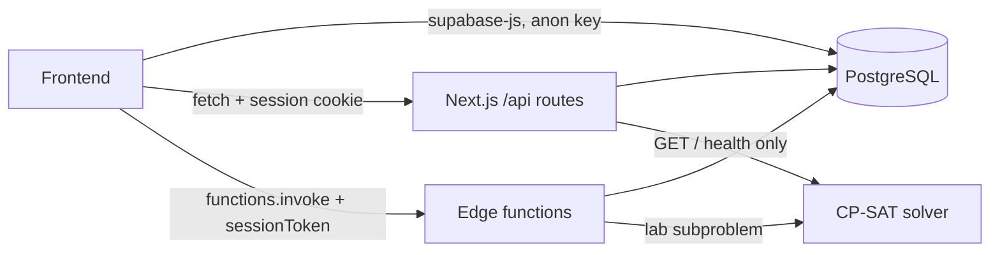
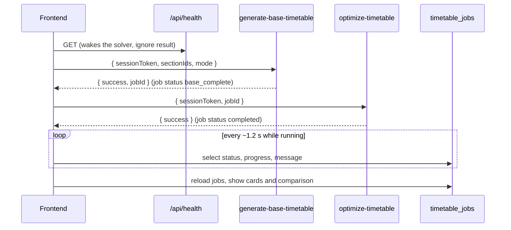
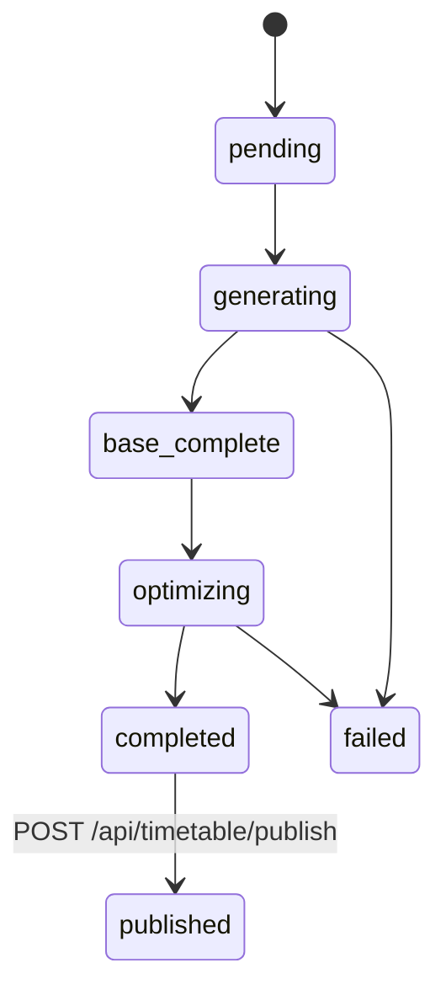

# Frontend–Backend Integration Guide

How a frontend connects to the backend of the Timetable Scheduling System: which backend to call for what, how to authenticate, the exact request and response shapes, and the generation → compare → publish flow. The reference implementation is the Next.js app in `my-app/`; every contract below is taken from that code, with the file named so you can check it.

> New to the product itself? Read [11 – User Guide & Complete Flow](./11-user-guide-and-complete-flow.md) first.

---

## 1. The four backends

A frontend talks to three of them. The fourth, the ILP solver, is called only by the edge functions.

| Backend | Used for | How the frontend calls it | Auth |
|---|---|---|---|
| **Supabase PostgreSQL** (via PostgREST) | Reading and editing data: colleges, departments, faculty, rooms, subjects, sections, jobs, timetable slots | `supabase-js` browser client with the **anon key** | none at the database level (allow-all RLS), so always scope queries yourself, see §4 |
| **Next.js API routes** (`/api/*`) | Logins, publishing, choosing a Pareto solution, department-admin accounts, registration requests, health | `fetch("/api/...")` from the same origin | session **cookie** `timetable_session_token` |
| **Supabase Edge Functions** | Generating, optimizing and rescheduling timetables | `supabase.functions.invoke(name, { body })` | session token sent **in the request body** as `sessionToken` |
| **ILP solver** (FastAPI + OR-Tools on Render) | CP-SAT lab placement (`/solve-labs`, `/solve-labs-diverse`) | **never directly**; only `GET /api/health` wakes it | none (internal) |



---

## 2. Environment setup

### 2.1 Frontend (`my-app/.env.local`)

| Variable | Exposed to browser | Purpose |
|---|---|---|
| `NEXT_PUBLIC_SUPABASE_URL` | yes | Supabase project URL |
| `NEXT_PUBLIC_SUPABASE_ANON_KEY` | yes | anon key for `supabase-js` and edge-function calls |
| `SUPABASE_SERVICE_ROLE_KEY` | **no**, server only | used by API routes; never import it in client code |
| `ILP_SOLVER_URL` | no | solver base URL, used by `/api/health` to wake it |
| `APP_URL` | no | public URL put in emails |
| `EMAIL_HOST`, `EMAIL_PORT`, `EMAIL_SECURE`, `EMAIL_USER`, `EMAIL_PASSWORD`, `EMAIL_FROM_NAME` | no | SMTP for registration emails |

Only variables prefixed `NEXT_PUBLIC_` reach the browser. Keep `SUPABASE_SERVICE_ROLE_KEY`, the SMTP password and any access tokens out of client components and out of git.

### 2.2 Edge functions (Supabase secrets)

```bash
supabase secrets set ILP_SOLVER_URL=https://<your-solver>.onrender.com
# SUPABASE_URL and SUPABASE_SERVICE_ROLE_KEY are provided by Supabase automatically
supabase functions deploy generate-base-timetable
supabase functions deploy optimize-timetable
```

### 2.3 Database

Run the SQL scripts in `my-app/scripts/` in numeric order. `021_college_department_hierarchy.sql` adds the roles, `department_admins`, the job columns, the `committed_timetable` view and the `publish_timetable_job` function.

### 2.4 Clients

```ts
// Browser (client components): lib/client.ts
import { getSupabaseBrowserClient } from "@/lib/client"
const supabase = getSupabaseBrowserClient()   // singleton, anon key

// Server components / route handlers: lib/server.ts
import { getSupabaseServerClient } from "@/lib/server"
const supabase = await getSupabaseServerClient()
```

---

## 3. Authentication

### 3.1 Login endpoints

All are `POST`, with a JSON body, and return the same shape.

| Role | Endpoint | Body | Home page |
|---|---|---|---|
| System admin | `/api/auth/login-admin` | `{ username, password }` | `/dashboard/admin` |
| College admin | `/api/auth/login-college-admin` | `{ username, password }` | `/college` |
| Department admin | `/api/auth/login-department-admin` | `{ username, password }` | `/department` |
| Faculty | `/api/auth/login-faculty` | `{ code, phone }` | `/faculty` |

**Success (200):**

```json
{
  "success": true,
  "message": "Login successful",
  "user": { "id": "…", "username": "univ_cse_admin", "name": "…", "department_id": "…", "college_id": "…" },
  "session": { "session_token": "64-hex-chars", "expires_at": "2026-10-24T10:00:00Z", "user_type": "department_admin" },
  "role": "department_admin"
}
```

**Failures** use `{ "success": false, "message": "…" }`:
- `400` missing fields
- `401` wrong credentials
- `403` account or college inactive
- `500` server error

Sessions last **24 hours** and are stored in the `user_sessions` table. The password is never returned.

### 3.2 Storing the session (required)

Both backends need the token, in two different places, so store it **both** ways. This is what `login()` in `contexts/AuthContext.tsx` does:

```ts
const SESSION_KEY = "timetable_session_token"
const ROLE_KEY = "timetable_user_role"

localStorage.setItem(SESSION_KEY, token)       // read by edge-function calls
localStorage.setItem(ROLE_KEY, role)
document.cookie = `${SESSION_KEY}=${token}; path=/; max-age=86400; SameSite=Lax; Secure`  // read by /api routes
document.cookie = `${ROLE_KEY}=${role}; path=/; max-age=86400; SameSite=Lax; Secure`
```

In the reference app, call `useAuth().login(session.session_token, role)` instead of writing these yourself. Read the token later with `getStoredSessionToken()` from `lib/auth.ts`.

> `Secure` cookies are not sent over plain `http://` except to `localhost`. Use HTTPS when testing on a LAN IP, or the API routes will answer 403.

### 3.3 Validating, guarding and logging out

| Need | Use |
|---|---|
| Who is signed in? | `useAuth()` returns `{ user, role, session, isLoading, isAuthenticated }`; it validates the stored token through `validateSession(token)` in `lib/auth.ts` |
| Protect a client page | `useRequireAuth(["faculty"])` returns `authorized`. Only load data once `authorized` is true: it sends unauthenticated visitors to that page's login and other roles to their own home |
| Protect a portal layout | `PortalLayout` (`components/portal-layout.tsx`) does the same for the college and department portals |
| Protect a server page | `requireCollegeAdminId()` / `requireDepartmentAdmin()` in `lib/server.ts` (they redirect) |
| Protect an API route | `getRequestSession(request, supabase, ["department_admin"])` in `lib/api-session.ts` returns `null` when the cookie is missing, expired or the role isn't allowed |
| Log out | `useAuth().logout()` deletes the session row and clears both storages |

A forged or expired token is rejected everywhere: the pages redirect to login, API routes return `403`, and edge functions return `401`.

---

## 4. Reading and writing data

The pages read data directly with `supabase-js`. Tenancy is **not** enforced by the database (the RLS policies allow everything for the anon key), so every query must be scoped to the caller:

```ts
import { getUserScope } from "@/lib/auth"
const { collegeId, departmentId } = getUserScope(user, role)
```

| Data | Table | Always filter by |
|---|---|---|
| Departments | `departments` | `college_id` |
| Faculty, availability | `faculty`, `faculty_availability` | `college_id` (availability via `faculty_id`) |
| Rooms | `classrooms` (`room_type` = `theory` / `lab`) | `college_id` |
| Subjects | `subjects` (`subject_type`, `periods_per_week`), `subject_faculty` | `college_id` |
| Sections and their courses | `sections` (`year_level`, `student_count`), `section_subjects` (subject + faculty per section) | `department_id` / `college_id` |
| Runs | `timetable_jobs` | `department_id` (department admin) or `college_id` (college admin) |
| Slots of a run | `timetable_base` (before optimization), `timetable_optimized` (final) | `job_id` |
| Everything published in a college | view `committed_timetable` | `college_id` |

**Slot rows:**
- `day_of_week`: 0 = Monday … 5 = Saturday
- `start_period`, `end_period`: 1–8; P1–P4 are in the morning, lunch falls between P4 and P5, and labs are 3 consecutive periods
- other columns: `section_id`, `subject_id`, `faculty_id`, `classroom_id`

**Row limit:** PostgREST returns at most **1000 rows** per request. A whole college easily has more published slots than that, so page with `.range(from, from + 999)` until fewer than 1000 rows come back. `selectAll()` in `supabase/functions/_shared/supabase-context.ts` and the paged read in `app/timetable/page.tsx` show the pattern.

**Example: a faculty member's published week** (`app/faculty/page.tsx`):

```ts
const { data } = await supabase
  .from("timetable_optimized")
  .select("*, sections(name), subjects(name, code, subject_type), classrooms(name, building), timetable_jobs!inner(is_published)")
  .eq("faculty_id", facultyId)
  .eq("timetable_jobs.is_published", true)
  .order("day_of_week").order("start_period")
```

**Account writes** that need password hashing go through API routes, never directly to the table:
- department-admin accounts use `/api/department-admin`, see §8
- college accounts use `/api/timetable-administrator/create`

Plain records (faculty, rooms, subjects, sections) are inserted, updated and deleted with `supabase-js` and must carry the right `college_id` / `department_id`.

---

## 5. Generating a timetable

### 5.1 The sequence



Both calls are long-running: seconds to about a minute, plus up to about a minute more if Render has to cold-start the solver. Show a progress state and don't time out early.

### 5.2 Calling edge functions

Use `invokeEdgeFunction` from `lib/edge.ts`. Plain `supabase.functions.invoke` reports every non-2xx response as a generic error and hides the message; this wrapper returns the JSON body either way.

```ts
import { invokeEdgeFunction } from "@/lib/edge"
import { getStoredSessionToken } from "@/lib/auth"

const sessionToken = getStoredSessionToken()
await fetch("/api/health").catch(() => {})            // wake the Render solver

const { data: base, error } = await invokeEdgeFunction("generate-base-timetable", {
  sessionToken,
  sectionIds: ["<section uuid>", "..."],              // any sections of the caller's department
  mode: "enhanced",                                   // or "baseline"
})
if (error || !base?.success) { /* show base.error, see 5.4 */ }

const { data: opt, error: optError } = await invokeEdgeFunction("optimize-timetable", {
  sessionToken,
  jobId: base.jobId,
})
```

### 5.3 `generate-base-timetable` (action `generate`, the default)

**Request:**

| Field | Type | Notes |
|---|---|---|
| `sessionToken` | string | department-admin session; any other role → `401` |
| `sectionIds` | string[] | sections to schedule. Ids from other departments are dropped; none left → `400` "Select at least one section of your department" |
| `mode` | `"baseline"` \| `"enhanced"` | anything else is treated as `baseline` |

**Success (200):**

```json
{ "success": true, "jobId": "uuid", "mode": "enhanced", "slotsGenerated": 203, "generationTime": 19025, "executionLogs": ["…"] }
```

The function automatically:
- treats faculty and rooms already used by **other** published timetables as occupied
- applies the college-wide room reservation
- deletes older **unpublished** runs of the same sections and mode

### 5.4 Error responses to handle

| `error` value | Extra fields | Show the user |
|---|---|---|
| `"INCOMPLETE_SCHEDULE"` | `details[]`: `{ section, subject, type, expected, scheduled, reason }`, plus `diagnostics` | which courses could not be placed and why (usually no free faculty or room periods) |
| `"CONFLICTS_DETECTED"` | `conflicts[]` (strings) | the validation conflicts |
| any other message | `executionLogs` | the message; logs are useful for support |
| `401` | | sign in again |

Failed runs also appear in `timetable_jobs` with `status = "failed"` and a `message`.

### 5.5 `optimize-timetable`

| Request | `{ sessionToken, jobId }` |
|---|---|
| `200` | `{ success: true, … }` and the job becomes `completed` |
| `400` | job is not `base_complete` ("Generate the base timetable first") |
| `404` | job not in your department |
| `409` | already being optimized (the job is claimed atomically, so a double-click is safe) |

Baseline runs the weighted-sum GA. Enhanced runs NSGA-II with SCPX and stores the best 3 Pareto timetables.

### 5.6 Progress polling and job states

```ts
// components/generate-timetable.tsx
supabase.from("timetable_jobs")
  .select("id, status, progress, message, created_at, updated_at")
  .eq("department_id", departmentId)
  .eq("created_by", userId)
  .gte("created_at", runStartedAtIso)
  .order("created_at", { ascending: false }).limit(1).maybeSingle()
```



`progress` runs 0–100 and `message` holds a human-readable stage. "Published" is not a status value: a published run is `status = "completed"` with `is_published = true` and `published_at` set.

### 5.7 Job fields used by the UI

| Column | Contents |
|---|---|
| `algorithm_mode` | `baseline` / `enhanced` |
| `run_type` | `full` or `reschedule` |
| `section_ids`, `section_key` | the selection; `section_key` is the sorted ids joined by commas, used to pair a baseline run and an enhanced run of the same selection |
| `base_generation_time`, `optimization_time` | ms |
| `metrics.final.hard` | `totalViolations`, `criticalViolations` (double bookings), `facultyOverlap`, `roomOverlap`, `sectionOverlap`, `crossDepartmentClash`, `facultyAvailability`, `theoryDailyLimit`, `calendarRules`, `roomTypeOrCapacity`, `coveragePercent`, `requiredPeriods`, `scheduledPeriods` |
| `metrics.final.objectives` | `facultyGap`, `studentGap`, `workloadBalance`, `morningPreference`, `labCompactness` (all 0–1, higher is better) |
| `metrics.final.quality` | weighted Q = 0.3·f1 + 0.25·f2 + 0.2·f3 + 0.15·f4 + 0.1·f5 |
| `metrics.process` | `constraintPreservation`, `crossoverAcceptance`, `initialDiversity`, `finalDiversity`, `mutationAttemptsPerAcceptedMove`, `hypervolume`, `populationHypervolume`, `paretoFrontSize`, `fullFrontSize`, `generationsRun`, `optimizationTimeMs` |
| `pareto_front` | enhanced only: up to 3 entries `{ objectives, quality, hard, slots }` |
| `selected_solution` | index of the Pareto entry currently in `timetable_optimized` |
| `is_published`, `published_at` | publication state |

`lib/metrics-display.ts` (`METRICS`) holds the labels, groups, "higher is better" flags and formatters for every metric. Reuse it to build a baseline-vs-enhanced table rather than hard-coding names.

---

## 6. Choosing a Pareto solution (enhanced runs)

```ts
await fetch("/api/timetable/select-solution", {
  method: "POST",
  headers: { "Content-Type": "application/json" },
  body: JSON.stringify({ jobId, index }),        // index into job.pareto_front
})
```

**Responses:**
- `200` `{ success: true, message: "Pareto solution #2 selected" }`: the slots in `timetable_optimized` are replaced
- `403` not a department admin
- `404` job not in your department
- `409` not an optimized run, or already published
- `400` unknown index

---

## 7. Publishing

```ts
const res = await fetch("/api/timetable/publish", {
  method: "POST",
  headers: { "Content-Type": "application/json" },
  body: JSON.stringify({ jobId, allowWarnings: false }),
})
const result = await res.json()
if (result.requiresConfirmation && confirm(result.message)) {
  // retry with allowWarnings: true
}
```

| Status | Body | Meaning |
|---|---|---|
| `200` | `{ success: true, message }` | published; these faculty and room periods are now occupied for every other department |
| `409` + `requiresConfirmation: true` | `{ message }` | the run breaks soft or other rules (availability, daily limit, missing periods). Ask the user and resend with `allowWarnings: true` |
| `409` | `{ success: false, message }` | **cannot** publish: it double-books, or slots now clash with a timetable another department published after this run was generated (the message names the first clash). Regenerate |
| `403` / `404` / `400` | | not a department admin / not your job / no `jobId` |

Publishing runs `publish_timetable_job(p_job_id)` inside a per-college lock, so two departments publishing at the same time can never create a clash. It replaces any older published run of the same sections.

---

## 8. Other API routes

| Route | Method | Who | Body / query | Purpose |
|---|---|---|---|---|
| `/api/department-admin` | `POST` | college admin | `{ department_id, username, password, name, email?, phone? }` | create the department's admin account (one per department; `409` if it exists; password ≥ 6 chars) |
| `/api/department-admin` | `PUT` | college admin | `{ id, name?, email?, phone?, is_active?, password? }` | edit, deactivate or reset the password |
| `/api/department-admin?id=<uuid>` | `DELETE` | college admin | | remove the account |
| `/api/timetable-administrator/create` | `POST` | system admin | college admin details | create a college |
| `/api/registration-request` | `POST` | public | registration form | a college asks for an account |
| `/api/registration-request` | `GET` | system admin | | list requests |
| `/api/registration-request/approve` | `POST` | system admin | `{ requestId }` | approve: creates the college account and emails the credentials |
| `/api/registration-request/reject` | `POST` | system admin | `{ requestId, rejectionReason }` | reject the request |
| `/api/health` | `GET` | anyone | | `{ db, solver }` status; also wakes the solver |

---

## 9. Incremental rescheduling

This is the same edge function with `action: "reschedule"`. It locks every unaffected slot and re-places only the periods that the disruption touches.

```ts
const { data } = await invokeEdgeFunction("generate-base-timetable", {
  action: "reschedule",
  sessionToken,
  parentJobId: publishedJobId,                        // a PUBLISHED run of your department
  disruption: { type: "faculty", facultyId, days: [0, 3] },   // or { type: "room", roomId, days }
})                                                    // days: 0 = Mon … 5 = Sat; [] = whole week
```

**Success:**

```json
{ "success": true, "jobId": "new uuid", "metrics": { "latencyMs": 16, "affectedSlots": 1, "totalSlots": 77,
  "scheduleAffectedFraction": 0.013, "periodsReplaced": 2, "periodsToReplace": 2, "qualityBefore": 0.804, "qualityAfter": 0.802 }, "hard": { … } }
```

The result is a new `completed` job with `run_type = "reschedule"`. It isn't published: show it, then publish it with §7.

---

## 10. Integration checklist

1. Set the `.env.local` variables, the `ILP_SOLVER_URL` secret and deploy both edge functions; run the SQL scripts.
2. Log in through the right `/api/auth/*` route and store the token in **localStorage and the cookie**.
3. Guard pages with `useRequireAuth` / `PortalLayout` / `require*` server helpers and load data only once authorized.
4. Scope every `supabase-js` query by `college_id` / `department_id`, and page reads over 1000 rows.
5. Generate: `GET /api/health`, then `generate-base-timetable`, then `optimize-timetable`, polling `timetable_jobs` for progress.
6. Compare runs with matching `section_key` using `metrics` and `lib/metrics-display.ts`.
7. Optionally switch the Pareto solution, then publish and handle the `requiresConfirmation` and clash responses.
8. Read published data from `timetable_optimized` joined with `timetable_jobs!inner(is_published)`, or from `committed_timetable`.

## 11. Troubleshooting

| Symptom | Cause / fix |
|---|---|
| Edge function returns `401` | `sessionToken` missing from the body, expired, or not a department admin |
| API route returns `403` while logged in | cookie not set (forgot the cookie half of §3.2, or `Secure` cookie on plain http) |
| First generation is very slow or times out | Render free tier cold start: call `/api/health` first and allow about 60 s |
| `INCOMPLETE_SCHEDULE` | not enough free faculty or room periods left for the selection; check faculty availability in the college **Faculty** grid, or plan fewer sections |
| Publish says slots now clash | another department published after your run; regenerate the same sections |
| Timetable views miss slots for big colleges | 1000-row limit: page the query (§4) |
| `Missing environment variable: NEXT_PUBLIC_SUPABASE_URL` | `.env.local` not loaded; restart `next dev` after editing it |
